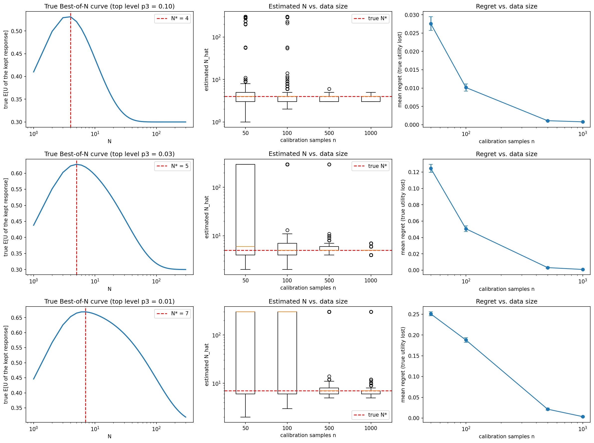

# Finite-Data Synthetic Simulation

**Objective:** Evaluate how reliably the optimal Best-of-N sample size can be estimated from limited calibration data.

Code: [`simulation.py`](simulation.py) · Figure: [`simulation.png`](simulation.png)

## Setup

We use a three-level verifier model with $p_j = P(S=s_j)$ and $m_j = E[U \mid S=s_j]$, where $U \in \{0,1\}$ indicates correctness (in the simulation, $U \mid S=s_j \sim \text{Bernoulli}(m_j)$).

We fix $m = (0.2, 0.7, 0.3)$, so the highest score level is over-optimized ($m_3 < m_2$, one-tail-crossover regime), and test three regimes with $p_3 \in \{0.10, 0.03, 0.01\}$, representing increasingly rare misleading high scores:

| Regime | $p = (p_1, p_2, p_3)$ |
|---|---|
| $p_3 = 0.10$ | (0.50, 0.40, 0.10) |
| $p_3 = 0.03$ | (0.50, 0.47, 0.03) |
| $p_3 = 0.01$ | (0.50, 0.49, 0.01) |

The expected utility of Best-of-N is exact. With $a = p_1 + p_2$ and $b = p_1$:

$$V(N) = E[U_{I_N}] = m_3 + (m_2 - m_3)\,a^N + (m_1 - m_2)\,b^N$$

(checked against Monte Carlo).

## Procedure

1. Compute the true optimal $N^\star$ using the theoretical expected utility formula (searching $N = 1, \dots, 300$).
2. Generate $n = 50, 100, 500, 1000$ labeled calibration samples $(S, U)$.
3. Estimate $\hat p_j$ (fraction of samples at level $j$) and $\hat m_j$ (mean utility at level $j$), plug them into $V(N)$, and calculate $\hat N^\star$.
4. Measure regret: $V(N^\star) - V(\hat N^\star)$, always evaluated on the **true** curve.
5. Repeat 1,000 times per setting (fixed seed).

**Unseen top level.** If level $s_3$ never appears in the calibration set, then $\hat p_3 = 0$ and the estimated curve is $\hat m_2 + (\hat m_1 - \hat m_2)\,\hat b^N$. When $\hat m_2 > \hat m_1$ this is increasing, so its best $N$ in the search range is $N_{\max} = 300$. (Without special handling, `argmax` would stop at $N \approx 55$, where $\hat b^N$ underflows to 0 and the curve becomes flat, which understates regret.) The code sets $\hat N^\star = N_{\max}$ in this case.

## Results

True optimal values: $N^\star = 4, 5, 7$ for $p_3 = 0.10, 0.03, 0.01$ respectively
($V(N^\star) = 0.531,\ 0.628,\ 0.669$; $V(1) = 0.410,\ 0.438,\ 0.446$; $V(300) = 0.300,\ 0.300,\ 0.320$).

### Mean regret (± standard error)

| $n$ | $p_3 = 0.10$ ($N^\star=4$) | $p_3 = 0.03$ ($N^\star=5$) | $p_3 = 0.01$ ($N^\star=7$) |
|---|---|---|---|
| 50 | 0.0276 ± 0.0019 | 0.1246 ± 0.0049 | 0.2510 ± 0.0049 |
| 100 | 0.0102 ± 0.0010 | 0.0507 ± 0.0036 | 0.1880 ± 0.0055 |
| 500 | 0.0011 ± 0.0001 | 0.0032 ± 0.0007 | 0.0215 ± 0.0026 |
| 1000 | 0.0008 ± 0.0000 | 0.0009 ± 0.0001 | 0.0035 ± 0.0010 |

### Estimated $\hat N^\star$ (mean / median)

| $n$ | $p_3 = 0.10$ | $p_3 = 0.03$ | $p_3 = 0.01$ |
|---|---|---|---|
| 50 | 23.4 / 4 | 112.0 / 6 | 213.8 / 300 |
| 100 | 8.0 / 4 | 46.8 / 5 | 162.5 / 300 |
| 500 | 3.7 / 4 | 6.4 / 5 | 23.9 / 7 |
| 1000 | 3.7 / 4 | 5.2 / 5 | 9.1 / 7 |

### How often the top level is missing from the calibration set

Fraction of the 1,000 trials in which $s_3$ never appeared. The exact probability is $(1 - p_3)^n$, shown in parentheses.

| $n$ | $p_3 = 0.10$ | $p_3 = 0.03$ | $p_3 = 0.01$ |
|---|---|---|---|
| 50 | 0.7% (0.5%) | 23.0% (21.8%) | 61.4% (60.5%) |
| 100 | 0.0% (0.0%) | 4.2% (4.8%) | 37.3% (36.6%) |
| 500 | 0.0% | 0.0% | 0.3% (0.7%) |
| 1000 | 0.0% | 0.0% | 0.0% |

### Mean $|\hat p_3 - p_3|$

| $n$ | $p_3 = 0.10$ | $p_3 = 0.03$ | $p_3 = 0.01$ |
|---|---|---|---|
| 50 | 0.0339 | 0.0198 | 0.0121 |
| 100 | 0.0236 | 0.0130 | 0.0072 |
| 500 | 0.0109 | 0.0059 | 0.0036 |
| 1000 | 0.0074 | 0.0044 | 0.0025 |

Note that the absolute error of $\hat p_3$ is *smallest* for the rarest regime, yet its regret is largest. What matters is not the size of the error in $\hat p_3$ but whether the level is seen at all.



Rows: $p_3 = 0.10, 0.03, 0.01$. Columns: true $V(N)$ curve with $N^\star$; distribution of $\hat N^\star$ per calibration size (log scale, red line = true $N^\star$); mean regret versus $n$.

## Findings

- **Regret decreases as calibration size increases** in every regime.
- **Rare misleading high scores require more calibration data**, because they may not appear in small samples. For example, when $p_3 = 0.01$, a calibration set of 50 samples misses the highest score level with probability $0.99^{50} \approx 60.5\%$ (61.4% observed).
- When the top level is missed, the estimated curve looks monotone increasing, so $\hat N^\star$ jumps to the search limit. On the true curve this is worse than $N=1$ (for $p_3 = 0.01$: $V(300) = 0.32$ vs. $V(1) = 0.45$).
- For $p_3 = 0.01$, $n = 50$ and $n = 100$ give the median $\hat N^\star = 300$ and regret of 0.25 and 0.19, compared with roughly 0.03 at $n=50$ for $p_3 = 0.10$.
- By $n = 500$ the regret is small ($\le 0.022$) in all regimes; by $n = 1000$ it is $\le 0.004$.

## Conclusion

Limited calibration data can cause severe overestimation of the optimal sampling budget, particularly when harmful high-score responses are rare.

## Assumptions and limitations

- $U \mid S=s_j \sim \text{Bernoulli}(m_j)$; all candidates are i.i.d. (no per-question structure).
- Search range is $N \in \{1, \dots, 300\}$; the "missed top level" result depends on this cap ($\hat N^\star = N_{\max}$).
- Plug-in estimator only; no smoothing, shrinkage, or prior on $p_3$ (these would probably help the unseen-level case).
- Single fixed $m$ and three values of $p_3$; the $p_1$ is held at 0.5.

## Reproduce

```bash
pip install numpy matplotlib
python simulation.py        # prints the tables above and writes simulation.png
```
