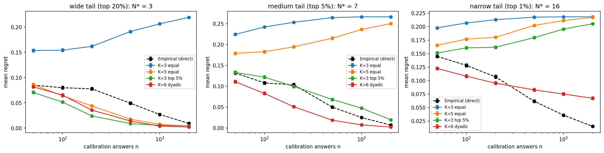

# Synthetic test of the level layout (continuous score, tail of different widths)

**Question:** on the real tables, equal-mass levels (K=3, K=5) failed where the peak of Best-of-N sits in the top 5-10% of the scores, and a "dyadic" layout (level masses halve towards the top) fixed it ([`PPE_RESULTS.md`](PPE_RESULTS.md)). Is that a general effect? This tests it in a controlled world where we choose where the peak is.

Code: [`layout_simulation.py`](../experiments/synthetic/layout_simulation.py) · Figure: [`layout_simulation.png`](layout_simulation.png)
`python experiments/synthetic/layout_simulation.py` (1 minute)

## Setup

- **World.** A continuous score, described by the rank quantile `u` of an answer's score (`u -> 1` is the top). The accuracy `m(u)` rises linearly from 0.2 to 0.7 up to `u = 1 - t`, then **falls to 0.3 over the top fraction `t`** (the over-optimized tail). Three tail widths: `t` = 20%, 5%, 1%, which place the peak of Best-of-N at **N\* = 3, 7, 16**. The true curve is exact: `V(N) = integral of m(u) N u^(N-1) du`.
- **Calibration data.** `n` labeled answers (quantile, correct ~ Bernoulli(m)), `n` = 50 to 2000, 1000 random sets per cell. Only the order matters: answers are sorted and cut into levels by rank, like the rank bins of the real tables.
- **Methods** (regret = V(N\*) - V(N_hat) on the true curve):
  - *Empirical (direct):* resample the `n` answers with replacement, keep the top one, take the argmax over N. No levels.
  - *Level layouts:* K=3 equal, K=5 equal, K=3 top 5% (0.50, 0.45, 0.05), K=6 dyadic (0.5, 0.25, 0.125, 0.0625, 0.031, 0.031); `m_hat_j` = mean correctness in level j, plugged into `V_hat(N) = sum_j m_hat_j (F_j^N - F_{j-1}^N)`.
- **Floor** = regret of the layout with unlimited data (its true level means).

## Results (mean regret)

| World (N\*) | Method | n=50 | n=100 | n=200 | n=500 | n=1000 | n=2000 | Floor |
|---|---|---|---|---|---|---|---|---|
| **Wide tail, top 20% (3)** | Empirical | 0.0850 | 0.0799 | 0.0777 | 0.0492 | 0.0271 | 0.0094 | 0 |
| | K=3 equal | 0.1535 | 0.1542 | 0.1618 | 0.1911 | 0.2063 | 0.2191 | 0.2246 |
| | K=5 equal | 0.0859 | 0.0639 | 0.0438 | 0.0177 | 0.0073 | 0.0041 | 0.0032 |
| | K=3 top 5% | 0.0705 | 0.0515 | 0.0242 | 0.0090 | 0.0054 | 0.0042 | 0.0032 |
| | K=6 dyadic | 0.0815 | 0.0652 | 0.0356 | 0.0141 | 0.0039 | 0.0020 | 0.0032 |
| **Medium tail, top 5% (7)** | Empirical | 0.1318 | 0.1079 | 0.1034 | 0.0499 | 0.0251 | 0.0069 | 0 |
| | K=3 equal | 0.2243 | 0.2420 | 0.2533 | 0.2645 | 0.2664 | 0.2664 | 0.2664 |
| | K=5 equal | 0.1787 | 0.1826 | 0.1944 | 0.2150 | 0.2359 | 0.2502 | 0.2664 |
| | K=3 top 5% | 0.1330 | 0.1218 | 0.0995 | 0.0683 | 0.0474 | 0.0196 | 0.0007 |
| | **K=6 dyadic** | 0.1108 | 0.0826 | 0.0509 | 0.0186 | 0.0073 | 0.0022 | 0.0000 |
| **Narrow tail, top 1% (16)** | Empirical | 0.1450 | 0.1282 | 0.1069 | 0.0617 | 0.0360 | 0.0152 | 0 |
| | K=3 equal | 0.1978 | 0.2068 | 0.2129 | 0.2176 | 0.2181 | 0.2181 | 0.2181 |
| | K=5 equal | 0.1653 | 0.1768 | 0.1803 | 0.2022 | 0.2112 | 0.2171 | 0.2181 |
| | K=3 top 5% | 0.1513 | 0.1606 | 0.1618 | 0.1796 | 0.1954 | 0.2053 | 0.2181 |
| | **K=6 dyadic** | 0.1225 | 0.1082 | 0.0952 | 0.0828 | 0.0751 | 0.0672 | 0.0030 |

## Findings

- **The real-data result is reproduced:** a layout works only if its levels resolve the tail where the accuracy falls. Equal-mass K=3 is catastrophic in all three worlds (floors 0.22 to 0.27, as bad as always using N=300: it merges the whole tail into a level that looks good). K=5 equal fails when the tail is narrower than its top level (20%): floors 0.27 and 0.22 for tails of 5% and 1%. "K=3 top 5%" works only when the tail is about 5% or wider.
- **The dyadic layout is robust: its floor is at most 0.003 in every world**, and it is the best method for few data: lower regret than the empirical method for every n in the medium tail (0.0073 vs 0.0251 at n=1000), at n >= 1000 in the wide tail (0.0039 vs 0.0271), and for n <= 200 in the narrow tail.
- **Limit of the dyadic layout:** when the tail is narrower than its finest level (1% vs 3.1%), it converges slowly (0.0672 at n=2000) and the direct empirical method wins from about n=300 (0.0152 at n=2000). A finer top level (a longer dyadic ladder: 1/64, 1/128, ...) would be needed, at the cost of more levels to estimate.
- **Few data:** with n=50 to 200 the layouts that fit the tail (top 5%, dyadic, K=5 in the wide tail) are about as good as or better than the empirical method (for example 0.0705 vs 0.0850 at n=50 in the wide tail), as on real tables with a handful of calibration questions.
- Together with the real tables: the K-level model is competitive with the direct empirical method only when the levels resolve the part of the score distribution that Best-of-N looks at. The dyadic rule (one level per power of two N) is a generic choice that does this without knowing the tail width.

## Caveats
- The accuracy profile is piecewise linear with a sharp tail; real reward models have smoother and noisier profiles.
- `n` counts labeled answers here; on real tables the calibration data are questions with many answers each (correlated within a question), so the effective sample size is smaller.
- Only the layouts listed were tried; the dyadic one was proposed after seeing the real PPE tables, here it is tested on a world built independently of them.
