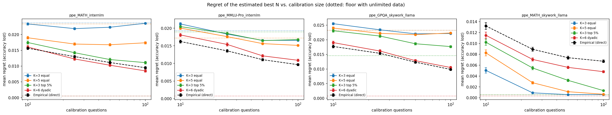

# PPE Best-of-K: the reward-model pairs of Khalaf et al.

**Question:** do the dataset / reward-model pairs that "Inference-Time Reward Hacking in Large Language Models" (Khalaf et al., NeurIPS 2025) uses show over-optimization (accuracy rises, then falls as N grows)? And how does our K-level method do on them?

Code: [`score_ppe.py`](../experiments/ppe/score_ppe.py), [`calibration_sweep.py`](../experiments/real_data/calibration_sweep.py) · Data: `results/ppe_<dataset>_<scorer>.csv`, `results/ppe_<dataset>_meta.csv`

## Data and scorers

- Pre-generated `lmarena-ai/PPE-{MATH, MMLU-Pro, GPQA}-Best-of-K`: each has 512 rows = 512 **different** questions, 32 answers per row from ONE generator (gemma-2-9b-it, gpt-4o-mini, Llama-3-8B-Instruct or claude-3-haiku, 128 rows each), with a correctness flag. So N <= 32. Mean correctness: MATH 0.34, MMLU-Pro 0.48, GPQA 0.41.
- Scorers: `internlm/internlm2-1_8b-reward` (InternLM-2 1.8B) and `Skywork/Skywork-Reward-Llama-3.1-8B`. The paper's text states that GPQA + Skywork-Llama-3.1 8B shows hacking; for the other pairs it gives no per-N numbers in the text (only in figures we could not read).
- Details: Skywork-Llama is scored in fp16 with BOS added by the tokenizer (batched vs single scores: max difference 0.047, correlation 0.999998). InternLM answers longer than 8,192 tokens (about 0.1%, degenerate repetitions) keep their last 8,192 tokens.

## Best-of-N curves

Accuracy of the kept answer (exact, N answers drawn without replacement), averaged over the 512 questions.

| Dataset + scorer | Mean score correct vs wrong | N=1 | N=2 | N=4 | N=8 | N=16 | N=32 | Best N (accuracy) | Decline after best N (95% CI) |
|---|---|---|---|---|---|---|---|---|---|
| **MATH + InternLM-2-1.8B** | -0.33 vs -0.70 | 0.344 | 0.373 | 0.389 | 0.392 | 0.383 | 0.369 | **7** (0.392) | 0.023 [-0.007, 0.053] |
| **MMLU-Pro + InternLM-2-1.8B** | +0.01 vs -0.20 | 0.476 | 0.503 | 0.514 | 0.518 | 0.519 | 0.502 | **13** (0.520) | 0.019 [-0.004, 0.041] |
| **GPQA + Skywork-Llama-3.1-8B** | +1.35 vs -2.80 | 0.406 | 0.430 | 0.444 | 0.452 | 0.448 | 0.430 | **10** (0.453) | 0.023 [-0.003, 0.049] |
| MATH + Skywork-Llama (control) | +7.81 vs -2.54 | 0.344 | 0.410 | 0.456 | 0.480 | 0.488 | 0.492 | 32 (0.492) | none, monotone |
| GPQA + InternLM-2-1.8B (control) | +0.28 vs +0.10 | 0.406 | 0.422 | 0.428 | 0.429 | 0.428 | 0.432 | 32 (0.432) | none, rises then flat |
| MMLU-Pro + Skywork-Llama (control) | -3.29 vs -9.63 | 0.476 | 0.537 | 0.578 | 0.604 | 0.624 | 0.631 | 30 (0.631) | none, monotone |

- **All three pairs from the paper show the rise-then-fall shape inside N <= 32**, with a peak at N of 7 to 13 and a loss of about 0.02 by N=32. The two pairs with the strong Skywork-Llama scorer on MATH and MMLU-Pro are monotone (controls).
- **Each decline is not significant on its own** (512 questions, intervals include 0; the best N is chosen on the same data, which makes the test optimistic if anything). The consistent direction in three independent datasets is the evidence, not any single interval.
- The loss from using N=32 instead of the best N is about 0.02 and from N=1 about 0.045: the peak matters, but sits at a small N.

## Is the decline real? Selection-free and pooled tests

The per-pair intervals above pick the best N on the same data (optimistic) and have low power. Two checks that remove the selection and add power (bootstrap over questions, 95% intervals; decline = accuracy at N0 minus accuracy at N=32):

| Test | MATH + InternLM | MMLU-Pro + InternLM | GPQA + Skywork-Llama | Pooled (1,536 questions) |
|---|---|---|---|---|
| N0 chosen on the OTHER two pairs (leave-one-pair-out; N0 = 11, 8, 8) | +0.0200 [-0.006, +0.046] | +0.0165 [-0.012, +0.045] | +0.0225 [-0.006, +0.051] | **+0.0196 [+0.004, +0.035]** |
| Fixed N0 = 8 for all (post hoc, common to the three peaks) | +0.0228 [-0.006, +0.051] | +0.0165 [-0.012, +0.045] | +0.0225 [-0.006, +0.050] | **+0.0206 [+0.004, +0.037]** |

- **Each pair alone is underpowered, not refuted:** the per-question standard deviation of the decline is about 0.33, so detecting a decline of 0.02 with 80% power needs about 1,600 to 3,000 questions per pair; each table has 512.
- **Pooled over the three pairs (selection-free) the decline is significant: about 0.02, 95% interval [+0.004, +0.035].** The qualitative claim (accuracy peaks at a small N and falls by N=32) holds on average across the paper's pairs, with a small effect size.
- Consequence for the project: the stake of choosing N well in these settings is small (at most about 0.02 to 0.05 accuracy); the interesting regimes are those with a sharper loss (MATH-500 + DeBERTa, -0.049) and the synthetic rare-top-level worlds.

## Calibration sweep (K-level model vs direct empirical)

Same procedure as [`CALIBRATION_SWEEP_RESULTS.md`](CALIBRATION_SWEEP_RESULTS.md): 80% of the questions as eval (410), 20% pool (102), up to 100 calibration questions, 1000 splits; mean regret (accuracy lost vs the real best N on the eval questions).

| Table (real best N, median) | Layout | n=10 | n=25 | n=50 | n=100 | Floor |
|---|---|---|---|---|---|---|
| MATH + InternLM (7) | K=3 equal | 0.0226 | 0.0216 | 0.0218 | 0.0230 | 0.0232 |
| | K=5 equal | 0.0191 | 0.0165 | 0.0158 | 0.0171 | 0.0229 |
| | K=3 top 5% | 0.0180 | 0.0142 | 0.0117 | 0.0111 | 0.0006 |
| | **K=6 dyadic** | 0.0163 | 0.0128 | 0.0099 | 0.0083 | 0.0006 |
| | Empirical (direct) | 0.0158 | 0.0133 | 0.0110 | 0.0091 | |
| MMLU-Pro + InternLM (13) | K=3 equal | 0.0220 | 0.0183 | 0.0168 | 0.0164 | 0.0191 |
| | K=5 equal | 0.0209 | 0.0176 | 0.0161 | 0.0155 | 0.0170 |
| | K=3 top 5% | 0.0217 | 0.0192 | 0.0172 | 0.0171 | 0.0188 |
| | **K=6 dyadic** | 0.0190 | 0.0155 | 0.0126 | 0.0111 | 0.0008 |
| | Empirical (direct) | 0.0169 | 0.0132 | 0.0112 | 0.0095 | |
| GPQA + Skywork-Llama (10) | K=3 equal | 0.0252 | 0.0229 | 0.0216 | 0.0221 | 0.0230 |
| | K=5 equal | 0.0244 | 0.0218 | 0.0214 | 0.0222 | 0.0230 |
| | K=3 top 5% | 0.0230 | 0.0211 | 0.0182 | 0.0173 | 0.0152 |
| | **K=6 dyadic** | 0.0193 | 0.0157 | 0.0125 | 0.0091 | 0.0008 |
| | Empirical (direct) | 0.0184 | 0.0151 | 0.0123 | 0.0089 | |
| MATH + Skywork-Llama, control (32) | K=3 equal | 0.0049 | 0.0011 | 0.0005 | 0.0005 | 0.0005 |
| | K=6 dyadic | 0.0115 | 0.0071 | 0.0056 | 0.0049 | 0.0003 |
| | Empirical (direct) | 0.0132 | 0.0094 | 0.0076 | 0.0070 | |

**Reading:**
- **Coarse equal-mass levels fail where there is a peak.** K=3 equal and K=5 equal put the top 33% / 20% of the answers in one level, but the peak lives in the top 5-10% (N* of 7 to 13 out of 32). They see a rising curve and choose N close to 32; their regret (about 0.016 to 0.023) is the same as the loss from N=32 (floor 0.017 to 0.023). The direct empirical method is clearly better than them (paired differences +0.003 to +0.014 at every size).
- **A level layout that resolves the top tail fixes this.** The dyadic layout (bottom 50%, then 25%, 12.5%, 6.25%, 3.1%, 3.1%: one level per power of two N) has a floor of 0.0006 to 0.0008 on the three peaked tables and is on par with the empirical method: slightly better on MATH + InternLM for n >= 25 (0.0083 vs 0.0091 at n=100), slightly worse on MMLU-Pro + InternLM (0.0111 vs 0.0095) and tied on GPQA (0.0091 vs 0.0089).
- On the monotone control the best layout is K=3 equal; dyadic and empirical are both worse than it, with dyadic better than empirical.
- **The dyadic layout was added after seeing that coarse levels fail on these tables** (post hoc), although as a rule it is generic (levels aligned with the N values that matter). On the earlier tables it behaves similarly to the empirical method (see `CALIBRATION_SWEEP_RESULTS.md`).
- Take-away: the K-level model is competitive with the direct empirical approach **only if the levels resolve the part of the score distribution that Best-of-N looks at**; K and the level masses are not free parameters.

## Caveats
- 512 questions per table, each question answered by one of four generators, so questions are heterogeneous; 32 answers per question limit the resolution of rank levels (the top 3% is a single answer).
- N <= 32: the curves after the peak are short.
- GPQA + InternLM-2-1.8B is a weak scorer here (mean score +0.28 for correct vs +0.10 for wrong answers): the curve rises a little and is flat, with no peak. It was scored but no sweep was run on it.
